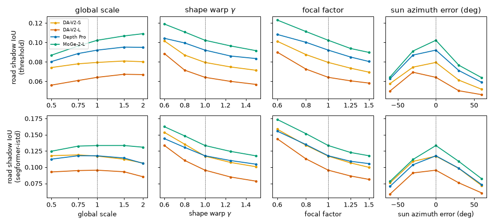
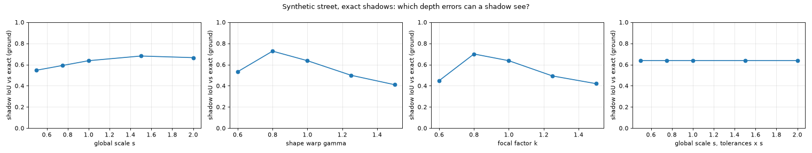

# Sun-Shadow 3D

Can the sun check a monocular depth map without labels? GPS and a timestamp give the exact sun direction. A correct depth map should then cast the shadows the camera actually sees.

This repo is the complete pilot study. Its main finding is partly negative, and it is written up as such.

## Findings

| Notebook | Question | Result |
|---|---|---|
| 01 `kitti_sun_direction` | Is our sun vector right on KITTI? | Yes. KITTI timestamps are local time (UTC+2). Pole shadows match the UTC+2 sun (az 175°, el 40°). |
| 02 `depth_and_rendered_shadows` | Do shadows rendered from depth match the real ones? | Only weakly. Road IoU is 0.06–0.30 from predicted depth (DA-V2-S) and 0.01–0.10 from LiDAR, because the casters (trees, facades) are above the LiDAR field of view. |
| 03 `corruption_study` | On real KITTI, does the score react to depth errors? | No. IoU stays ~0.07 for global scale ×0.5–2, shape warp and wrong focal. It does react to a wrong sun azimuth (±60° → 0.03), so the sun pipeline itself is sound. |
| 04 `synthetic_identifiability` | Physics or pipeline? (exact synthetic street) | **Both.** See below. |
| 05 `kitti_study` | Full study: 5 drives, 71 frames, DA-V2-S/L, Depth Pro, MoGe-2-L, threshold and a SegFormer-b2 shadow net trained on ISTD (test BER 1.9 %) | **No.** Scale is flat. Shape and focal move the score the wrong way: IoU is highest for compressed depth, and per frame the truth wins only 5-10 % of the time (chance 20 %). The score ranks DA-V2-L below DA-V2-S. See below. |
| 06 `coverage_bias` | Why does compressed depth score better? | **Coverage bias.** Compressed depth casts 1.3x more shadow and IoU follows the area. At the true depth the IoU (0.064) equals that of two independent masks of the same coverage (0.063), kappa -0.003: no agreement beyond chance. |

What the synthetic street (notebook 04) shows:

- **Global metric scale is unidentifiable from shadows.** A sun at infinity casts the same image-space shadows on a scaled scene. When the renderer's metric tolerances scale with the scene, the IoU is exactly constant (0.637 at every scale from 0.5 to 2).
- **Relative shape and focal length are identifiable.** With exact shadows, IoU falls from 0.64 to 0.41–0.45 at ±50 % warp or focal error.
- **So on KITTI the shape and focal signal was lost to the pipeline:** the dark-asphalt shadow detector and casters that are off-screen or above the LiDAR.

What the full KITTI study (notebook 05, run on Kaggle) adds:

- **A better shadow detector raises the IoU level (0.12 vs 0.08) but not its meaning.** The score still rises as depth is compressed. Per frame the true focal has the best score only 5 % of the time (95 % drive-bootstrap interval 3-8 %), far below the 20 % of chance; on average a 0.6 focal factor scores 0.042 IoU better than the true one. This fits a coverage bias: longer rendered shadows overlap more of a detector that marks about a fifth of the road.
- **One frame says little even about the sun.** The mean curve peaks at the true sun azimuth, but a single frame has its best score there only 26 % of the time.
- **It does not rank depth models.** MoGe-2-L scores highest and DA-V2-L lowest.



**Consequence:** the original claim, "a label-free check for *metric* depth", is impossible in principle. A shadow check can at most test relative shape and camera intrinsics. Even that needs a much better shadow detector and scenes with visible casters. `PLAN.md` (kept on the laptop) has the full reasoning and the reviewer concerns.



## Layout

```
sun-shadow-3d/
├── src/
│   ├── kitti.py        KITTI raw readers: oxts, timestamps, calibration chain, velodyne -> depth
│   ├── sun.py          sun azimuth/elevation (pvlib) and its direction in the camera frame
│   ├── shadows.py      screen-space shadow rendering from a depth map
│   ├── scene.py        SegFormer / Mask2Former road masks, dark-asphalt and learned shadow detectors, IoU, kappa
│   ├── shadow_net.py   SegFormer mit-b2 shadow detector trained on ISTD (train, evaluate, BER)
│   ├── depth_models.py DA-V2-S/L, Depth Pro, MoGe-2-L behind one predict() call
│   └── synthetic.py    exact synthetic street: depth by ray casting, exact 3D shadows
├── notebooks/          01-06, jupytext .py + executed .ipynb, run one at a time
├── tests/              pytest: sun position, rotations, ground plane, scale invariance
├── scripts/            download_kitti.sh, shadow_study.py (full study), kaggle_build.py,
│                       make_paper_numbers.py, make_paper_figures.py, kaggle_paper.py
├── kaggle/             one-file Kaggle kernel template for the study (GPU)
├── outputs/figures/
├── outputs/study/      study CSV, shadow-net metrics, argmax-at-truth and ranking tables
├── logs/kaggle/        Kaggle run logs
├── paper/            CVPR-style paper: main.tex, sec/, gen/ (generated numbers and tables), fig/
├── PLAN.md             plan, reviewer concerns and findings log (laptop only, not in git)
└── requirements.txt
```

## Run

```bash
uv venv --python 3.12 .venv
uv pip install --python .venv/bin/python --index-url https://download.pytorch.org/whl/cpu torch
uv pip install --python .venv/bin/python -r requirements.txt
.venv/bin/python -m ipykernel install --user --name sun-shadow-3d
scripts/download_kitti.sh                     # ~0.45 GB, drive 2011_09_26_0001
.venv/bin/python -m pytest -q tests

cd notebooks
../.venv/bin/jupytext --to ipynb 04_synthetic_identifiability.py
../.venv/bin/jupyter nbconvert --to notebook --execute --inplace \
    --ExecutePreprocessor.kernel_name=sun-shadow-3d 04_synthetic_identifiability.ipynb
```

Everything runs on a CPU. Notebooks 02 and 03 take a few minutes each, because they run DA-V2-S and SegFormer-b0.

## Paper

`paper/main.tex` writes the study up as a negative result with the identifiability theory
(scale invariance, focal error = sun error, the bound on the equivalent sun error). Every number in it is a macro
from `scripts/make_paper_numbers.py`, and the figures come from `scripts/make_paper_figures.py`.
The laptop has no LaTeX, so it is compiled on a Kaggle CPU kernel:

```bash
.venv/bin/python scripts/make_paper_numbers.py
.venv/bin/python scripts/make_paper_figures.py
.venv/bin/python scripts/kaggle_paper.py <kaggle-user>
kaggle datasets version -p kaggle/build/paper_data -m update --dir-mode zip   # first time: datasets create
kaggle kernels push -p kaggle/build/paper
kaggle kernels output <kaggle-user>/sun-shadow-3d-paper -p paper/build   # main.pdf + LaTeX logs
```

## Prior work

- Abrams, Miskell, Pless. *The Episolar Constraint*, CVPR 2013. Sparse depth from sun and shadow correspondences on webcams.
- Lalonde et al. *What do the sun and sky tell us about the camera?*, IJCV 2010.
- OutCast (2204.09341) and ShadowNeuS (2211.14086). Shadows for relighting and per-scene shape.
